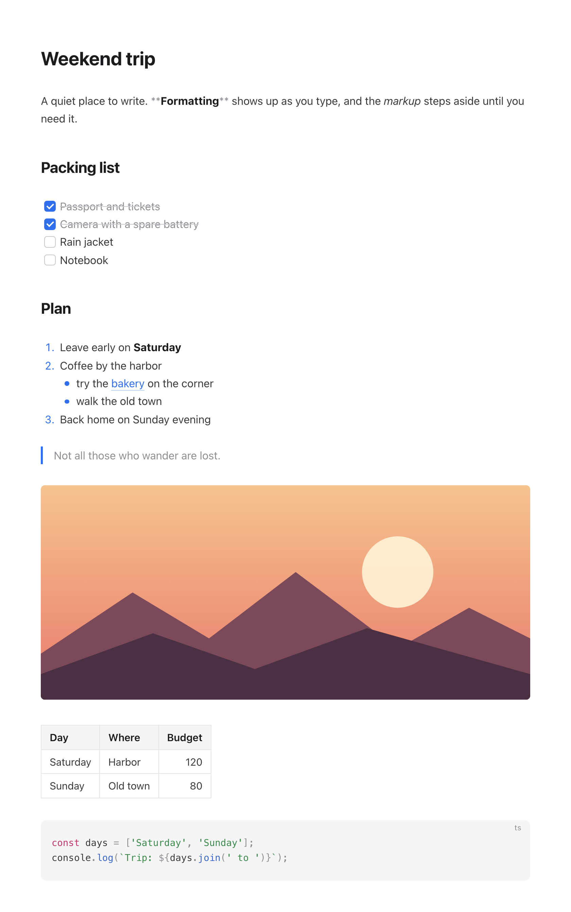
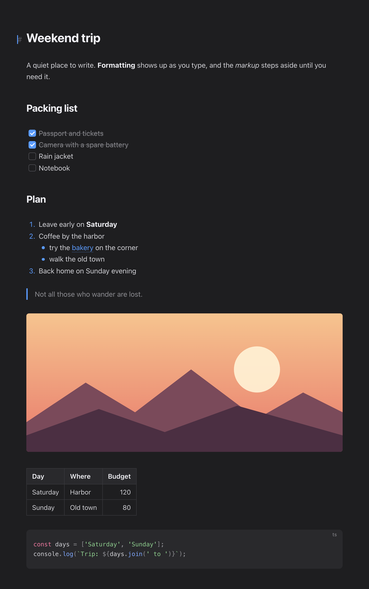

# Markhov

A quiet, minimal live preview editor for Markdown in VS Code. Formatting renders right where you type, and the markup only shows up around the cursor.



## Why Markhov

- **Write in the preview.** Headings, emphasis, lists, tasks, quotes, tables, images and code blocks render in place. Move the cursor into any of them and the Markdown appears, so you can edit it directly. Heading marks hang in the margin, so text never jumps around.
- **Opens only when you ask.** Markdown files keep opening in the normal text editor. Press <kbd>Cmd</kbd>+<kbd>Shift</kbd>+<kbd>M</kbd> to switch the current tab to Markhov in place, and press it again to go back. Unsaved changes come along.
- **Your file stays your file.** Markhov edits the text itself and never rewrites it, so there are no surprise reformats and git diffs stay clean. Undo, save, hot exit and outside changes (git, formatters, other editors) all just work.
- **Standard Markdown.** CommonMark plus GitHub Flavored Markdown: task lists, tables, strikethrough, autolinks and YAML front matter. No custom syntax.
- **Clean PDF export.** One click saves a PDF next to your file, with the same typography, page numbers and no browser headers.



## Getting started

1. Open any `.md` file.
2. Press <kbd>Cmd</kbd>+<kbd>Shift</kbd>+<kbd>M</kbd> (<kbd>Ctrl</kbd>+<kbd>Shift</kbd>+<kbd>M</kbd> on Windows and Linux), or click the preview icon in the editor title bar.
3. Press it again to return to the raw text.

You can also right-click a Markdown file in the Explorer and choose **Open with Markhov**. To always open Markdown files in Markhov, add this to your settings:

```json
"workbench.editorAssociations": { "*.md": "markhov.editor" }
```

## Editing

| Action | macOS | Windows and Linux |
| --- | --- | --- |
| Switch between Markhov and raw text | <kbd>Cmd</kbd>+<kbd>Shift</kbd>+<kbd>M</kbd> | <kbd>Ctrl</kbd>+<kbd>Shift</kbd>+<kbd>M</kbd> |
| Bold | <kbd>Cmd</kbd>+<kbd>B</kbd> | <kbd>Ctrl</kbd>+<kbd>B</kbd> |
| Italic | <kbd>Cmd</kbd>+<kbd>I</kbd> | <kbd>Ctrl</kbd>+<kbd>I</kbd> |
| Inline code | <kbd>Cmd</kbd>+<kbd>E</kbd> | <kbd>Ctrl</kbd>+<kbd>E</kbd> |
| Strikethrough | <kbd>Cmd</kbd>+<kbd>Shift</kbd>+<kbd>X</kbd> | <kbd>Ctrl</kbd>+<kbd>Shift</kbd>+<kbd>X</kbd> |
| Link | <kbd>Cmd</kbd>+<kbd>K</kbd> | <kbd>Ctrl</kbd>+<kbd>K</kbd> |
| Heading 1 to 6 | <kbd>Cmd</kbd>+<kbd>Alt</kbd>+<kbd>1</kbd> … <kbd>6</kbd> | <kbd>Ctrl</kbd>+<kbd>Alt</kbd>+<kbd>1</kbd> … <kbd>6</kbd> |
| Back to paragraph | <kbd>Cmd</kbd>+<kbd>Alt</kbd>+<kbd>0</kbd> | <kbd>Ctrl</kbd>+<kbd>Alt</kbd>+<kbd>0</kbd> |
| Add or check a task | <kbd>Cmd</kbd>+<kbd>Enter</kbd> | <kbd>Ctrl</kbd>+<kbd>Enter</kbd> |
| Nest or unnest a list item | <kbd>Tab</kbd> / <kbd>Shift</kbd>+<kbd>Tab</kbd> | <kbd>Tab</kbd> / <kbd>Shift</kbd>+<kbd>Tab</kbd> |
| Find and replace | <kbd>Cmd</kbd>+<kbd>F</kbd> | <kbd>Ctrl</kbd>+<kbd>F</kbd> |
| Open a link | <kbd>Cmd</kbd>+click | <kbd>Ctrl</kbd>+click |

Lists behave the way you expect: <kbd>Enter</kbd> continues a list (numbers count up, tasks start unchecked), <kbd>Enter</kbd> on an empty item leaves the list, and <kbd>Backspace</kbd> at the start of an item removes its bullet. Click a checkbox to toggle it, or click a table cell to edit its source.

The <kbd>Cmd</kbd>+<kbd>Shift</kbd>+<kbd>M</kbd> binding only applies while a Markdown editor has focus; everywhere else it still toggles the Problems panel. You can change it in Keyboard Shortcuts by searching for `markhov.toggle`.

## PDF export

Click the PDF icon in the editor title bar, or run **Markhov: Export to PDF** from the Command Palette or the Explorer context menu. The PDF is saved next to the Markdown file with the same name, including any unsaved edits.

Export uses a Chromium-based browser in the background (Google Chrome, Chromium, Microsoft Edge or Brave), which gives the same text rendering as a browser and full support for every language, tables and code highlighting. No browser window opens. If your browser is installed in an unusual place, set `markhov.pdf.chromePath`.

## Settings

| Setting | Default | Description |
| --- | --- | --- |
| `markhov.appearance` | `auto` | `light`, `dark`, or `auto` to follow the VS Code theme. |
| `markhov.colors` | `bear` | `bear` for the Markhov palette, `vscode` to use the colors of your VS Code theme. |
| `markhov.fontSize` | `16` | Base font size in pixels. |
| `markhov.lineHeight` | `1.65` | Line height of body text. |
| `markhov.maxWidth` | `720` | Maximum width of the text column in pixels. |
| `markhov.fontFamily` | system font | Font family for body text. |
| `markhov.pdf.pageSize` | `A4` | `A4` or `Letter`. |
| `markhov.pdf.open` | `none` | Open the PDF after exporting: `none`, `default` (system PDF app) or `browser`. |
| `markhov.pdf.chromePath` | detected | Path to the browser used for PDF export. |

## Good to know

- A single line break is shown as a line break, and PDF export keeps it that way. Some other renderers, such as GitHub, join such lines into one paragraph.
- Inside Markhov, <kbd>Cmd</kbd>+<kbd>K</kbd> inserts a link, so VS Code chords that start with <kbd>Cmd</kbd>+<kbd>K</kbd> are not available while the editor has focus.
- With Remote SSH, WSL or containers, PDF export needs a browser on the remote machine.

## Development

```sh
npm install
npm run build        # or: npm run watch
npm test             # unit tests
npm run test:integration
```

Press <kbd>F5</kbd> in VS Code to launch an Extension Development Host. To work on the editor in a browser, serve the project root and open `harness/index.html`.

## License

[MIT](LICENSE)
