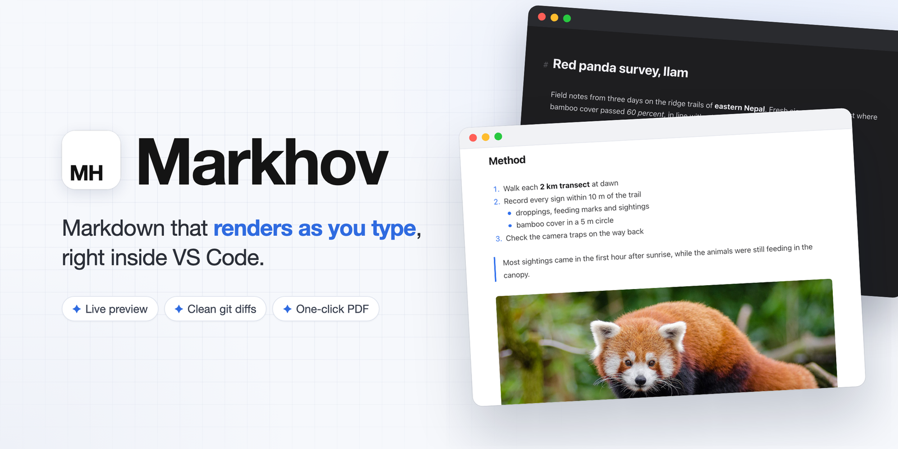
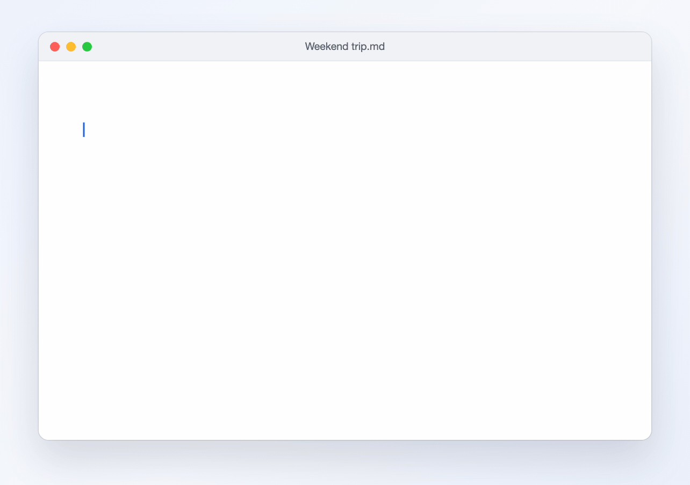
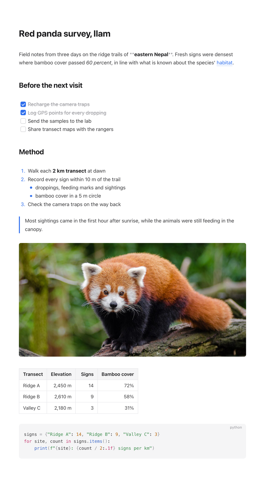
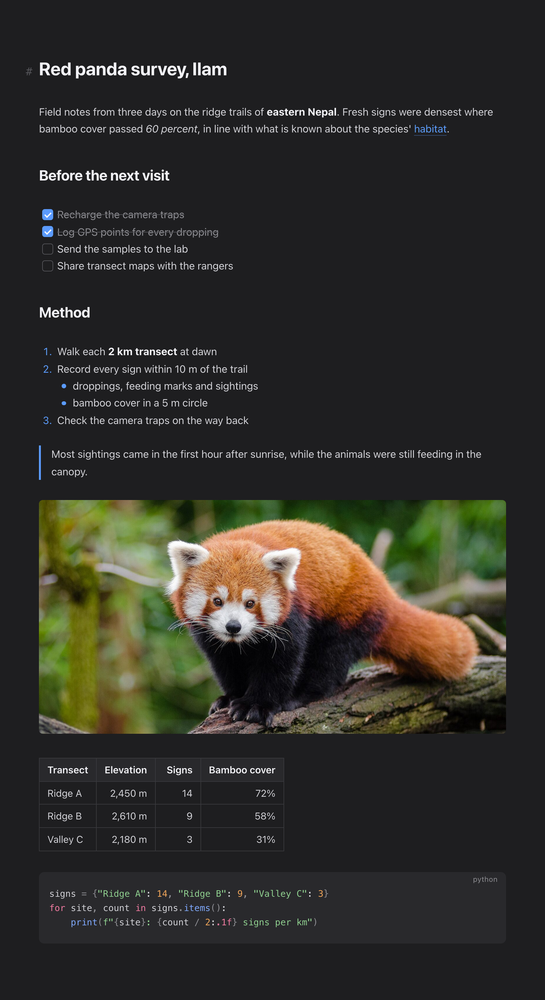

<p align="center">
  
</p>

<p align="center">
  <a href="https://marketplace.visualstudio.com/items?itemName=jbaehova.markhov"></a>
  <a href="https://code.visualstudio.com/"></a>
  <a href="https://github.com/jbaehova/markhov/actions/workflows/ci.yml"></a>
  <a href="https://github.com/jbaehova/markhov/releases/latest"></a>
  <a href="LICENSE"></a>
</p>

<p align="center">
  <b>A quiet, minimal live preview editor for Markdown in VS Code.</b><br>
  Formatting renders right where you type, and the markup only shows up around the cursor.
</p>

<p align="center">
  <a href="https://marketplace.visualstudio.com/items?itemName=jbaehova.markhov"><b>Install</b></a>
  &nbsp;&nbsp;|&nbsp;&nbsp;
  <a href="#features">Features</a>
  &nbsp;&nbsp;|&nbsp;&nbsp;
  <a href="#keyboard-shortcuts">Shortcuts</a>
  &nbsp;&nbsp;|&nbsp;&nbsp;
  <a href="#pdf-export">PDF export</a>
  &nbsp;&nbsp;|&nbsp;&nbsp;
  <a href="#settings">Settings</a>
  &nbsp;&nbsp;|&nbsp;&nbsp;
  <a href="CHANGELOG.md">Changelog</a>
</p>

<br>

<p align="center">
  
</p>

## Features

<table>
  <tr>
    <td width="50%" valign="top">
      <h3>✍️ Write in the preview</h3>
      <p>Headings, emphasis, lists, tasks, quotes, tables, images and code blocks render in place. Move the cursor into any of them and the Markdown appears, so you can edit it directly. Heading marks hang in the margin, so text never jumps around.</p>
    </td>
    <td width="50%" valign="top">
      <h3>⚡ Opens only when you ask</h3>
      <p>Markdown files keep opening in the normal text editor. Press <kbd>Cmd</kbd>+<kbd>Shift</kbd>+<kbd>M</kbd> to switch the current tab to Markhov in place, and press it again to go back. Unsaved changes come along.</p>
    </td>
  </tr>
  <tr>
    <td width="50%" valign="top">
      <h3>🔒 Your file stays your file</h3>
      <p>Markhov edits the text itself and never rewrites it, so there are no surprise reformats and git diffs stay clean. Undo, save, hot exit and outside changes from agents, git, formatters or other editors all just work.</p>
    </td>
    <td width="50%" valign="top">
      <h3>📐 Standard Markdown</h3>
      <p>CommonMark plus GitHub Flavored Markdown: task lists, tables, strikethrough, autolinks and YAML front matter. No custom syntax, nothing to lock you in.</p>
    </td>
  </tr>
  <tr>
    <td width="50%" valign="top">
      <h3>📝 Lists like Notion, Bear or Typora</h3>
      <p>Enter continues a list, Tab and Shift+Tab nest from anywhere in an item, and numbered lists renumber themselves. <a href="#lists">More below.</a></p>
    </td>
    <td width="50%" valign="top">
      <h3>📄 Clean PDF export</h3>
      <p>One click saves a PDF next to your file, with the editor's typography and spacing, page numbers and no browser headers.</p>
    </td>
  </tr>
</table>

### Light and dark

<table>
  <tr>
    <td></td>
    <td></td>
  </tr>
</table>

Markhov follows your VS Code theme by default. You can also pin it to light or dark, and switch between the Markhov palette and the colors of your VS Code theme.

## Install

Install **Markhov** from the [Visual Studio Marketplace](https://marketplace.visualstudio.com/items?itemName=jbaehova.markhov), or from the command line:

```sh
code --install-extension jbaehova.markhov
```

For editors that do not use the Visual Studio Marketplace, download the `.vsix` file from the [latest release](https://github.com/jbaehova/markhov/releases/latest) and run **Extensions: Install from VSIX...** from the Command Palette.

## Getting started

1. Open any `.md` file.
2. Press <kbd>Cmd</kbd>+<kbd>Shift</kbd>+<kbd>M</kbd> (<kbd>Ctrl</kbd>+<kbd>Shift</kbd>+<kbd>M</kbd> on Windows and Linux), or click the preview icon in the editor title bar.
3. Press it again to return to the raw text.

You can also right-click a Markdown file in the Explorer and choose **Open with Markhov**. To always open Markdown files in Markhov, add this to your settings:

```json
"workbench.editorAssociations": { "*.md": "markhov.editor" }
```

## Keyboard shortcuts

| Action | macOS | Windows and Linux |
| --- | --- | --- |
| Switch between Markhov and raw text | <kbd>Cmd</kbd>+<kbd>Shift</kbd>+<kbd>M</kbd> | <kbd>Ctrl</kbd>+<kbd>Shift</kbd>+<kbd>M</kbd> |
| Bold | <kbd>Cmd</kbd>+<kbd>B</kbd> | <kbd>Ctrl</kbd>+<kbd>B</kbd> |
| Italic | <kbd>Cmd</kbd>+<kbd>I</kbd> | <kbd>Ctrl</kbd>+<kbd>I</kbd> |
| Inline code | <kbd>Cmd</kbd>+<kbd>E</kbd> | <kbd>Ctrl</kbd>+<kbd>E</kbd> |
| Strikethrough | <kbd>Cmd</kbd>+<kbd>Shift</kbd>+<kbd>X</kbd> | <kbd>Ctrl</kbd>+<kbd>Shift</kbd>+<kbd>X</kbd> |
| Heading 1 to 6 | <kbd>Cmd</kbd>+<kbd>Alt</kbd>+<kbd>1</kbd> … <kbd>6</kbd> | <kbd>Ctrl</kbd>+<kbd>Alt</kbd>+<kbd>1</kbd> … <kbd>6</kbd> |
| Back to paragraph | <kbd>Cmd</kbd>+<kbd>Alt</kbd>+<kbd>0</kbd> | <kbd>Ctrl</kbd>+<kbd>Alt</kbd>+<kbd>0</kbd> |
| Add or check a task | <kbd>Cmd</kbd>+<kbd>Enter</kbd> | <kbd>Ctrl</kbd>+<kbd>Enter</kbd> |
| Nest or unnest a list item | <kbd>Tab</kbd> / <kbd>Shift</kbd>+<kbd>Tab</kbd> | <kbd>Tab</kbd> / <kbd>Shift</kbd>+<kbd>Tab</kbd> |
| Nest or unnest a list item (alternative) | <kbd>Cmd</kbd>+<kbd>]</kbd> / <kbd>Cmd</kbd>+<kbd>[</kbd> | <kbd>Ctrl</kbd>+<kbd>]</kbd> / <kbd>Ctrl</kbd>+<kbd>[</kbd> |
| New line inside a list item | <kbd>Shift</kbd>+<kbd>Enter</kbd> | <kbd>Shift</kbd>+<kbd>Enter</kbd> |
| Find and replace | <kbd>Cmd</kbd>+<kbd>F</kbd> | <kbd>Ctrl</kbd>+<kbd>F</kbd> |
| Open a link | <kbd>Cmd</kbd>+click | <kbd>Ctrl</kbd>+click |

Click a checkbox to toggle it, or click a table cell to edit its source.

The <kbd>Cmd</kbd>+<kbd>Shift</kbd>+<kbd>M</kbd> binding only applies while a Markdown editor has focus; everywhere else it still toggles the Problems panel. You can change it in Keyboard Shortcuts by searching for `markhov.toggle`.

### Lists

Lists behave the way you expect from Notion, Bear or Typora:

- <kbd>Enter</kbd> continues a list. Numbers count up and tasks start unchecked. <kbd>Shift</kbd>+<kbd>Enter</kbd> adds a line to the same item instead.
- <kbd>Enter</kbd> on an empty item moves it up one level, back into the parent list, or leaves the list when it is already at the top.
- <kbd>Tab</kbd> and <kbd>Shift</kbd>+<kbd>Tab</kbd> work from anywhere in the item and on several selected items at once. Children move along, the indentation always matches what Markdown needs under `1.` or `-`, and numbered lists renumber themselves.
- <kbd>Backspace</kbd> on an empty item removes it, and items nested under it move out one level. At the start of an item with text it removes the bullet.
- In a paragraph that belongs to an item (indented under it after a blank line), <kbd>Shift</kbd>+<kbd>Tab</kbd> moves the paragraph out one level.
- Typing `- ` or `1. ` on an empty item switches it between bullets and numbers, and `[] ` makes it a task. Undo once to keep what you typed.

## PDF export

Click the PDF icon in the editor title bar, or run **Markhov: Export to PDF** from the Command Palette or the Explorer context menu. The PDF is saved next to the Markdown file with the same name, including any unsaved edits.

The PDF keeps the editor's layout, blank lines included, and follows the font size, line height and font settings.

Export uses a Chromium-based browser in the background (Google Chrome, Chromium, Microsoft Edge or Brave), which gives the same text rendering as a browser and full support for every language, tables and code highlighting. No browser window opens. If your browser is installed in an unusual place, set `markhov.pdf.chromePath`.

## Settings

Right-click anywhere in the editor to change how the page looks or how PDFs are exported. Each setting opens a submenu with a check mark next to the current value, and **More Settings...** opens the full list below.

| Setting | Default | Description |
| --- | --- | --- |
| `markhov.appearance` | `auto` | `light`, `dark`, or `auto` to follow the VS Code theme. |
| `markhov.colors` | `bear` | `bear` for the Markhov palette, `vscode` to use the colors of your VS Code theme. |
| `markhov.fontSize` | `16` | Base font size in pixels. |
| `markhov.lineHeight` | `1.65` | Line height of body text. |
| `markhov.width` | `medium` | Width of the text column, in five steps from `veryNarrow` (560 pixels) to `veryWide` (1080 pixels). |
| `markhov.fontFamily` | system font | Font family for body text. |
| `markhov.pdf.pageSize` | `A4` | `A4` or `Letter`. |
| `markhov.pdf.open` | `none` | Open the PDF after exporting: `none`, `default` (system PDF app) or `browser`. |
| `markhov.pdf.chromePath` | detected | Path to the browser used for PDF export. |

## Good to know

- A single line break is shown as a line break, and PDF export keeps it that way. Some other renderers, such as GitHub, join such lines into one paragraph.
- With Remote SSH, WSL or containers, PDF export needs a browser on the remote machine.

## Development

```sh
npm install
npm run build        # or: npm run watch
npm test             # unit tests
npm run test:integration
```

Press <kbd>F5</kbd> in VS Code to launch an Extension Development Host. To work on the editor in a browser, serve the project root and open `harness/index.html`.

Bug reports and ideas are welcome in [Issues](https://github.com/jbaehova/markhov/issues).

## License

[MIT](LICENSE) © Johnny Bae
