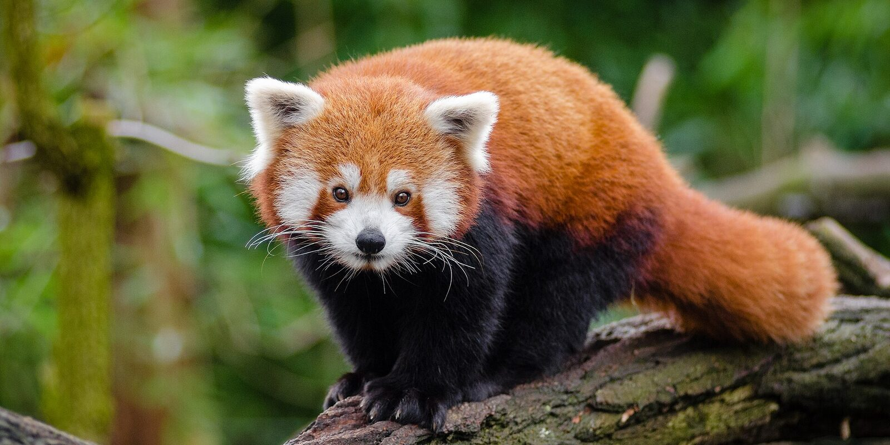

# Red panda survey, Ilam

Field notes from three days on the ridge trails of **eastern Nepal**. Fresh signs were densest where bamboo cover passed *60 percent*, in line with what is known about the species' [habitat](https://en.wikipedia.org/wiki/Red_panda).

## Before the next visit

- [x] Recharge the camera traps
- [x] Log GPS points for every dropping
- [ ] Send the samples to the lab
- [ ] Share transect maps with the rangers

## Method

1. Walk each **2 km transect** at dawn
2. Record every sign within 10 m of the trail
   - droppings, feeding marks and sightings
   - bamboo cover in a 5 m circle
3. Check the camera traps on the way back

> Most sightings came in the first hour after sunrise, while the animals were still feeding in the canopy.



| Transect | Elevation | Signs | Bamboo cover |
|:--|--:|--:|--:|
| Ridge A | 2,450 m | 14 | 72% |
| Ridge B | 2,610 m | 9 | 58% |
| Valley C | 2,180 m | 3 | 31% |

```python
signs = {"Ridge A": 14, "Ridge B": 9, "Valley C": 3}
for site, count in signs.items():
    print(f"{site}: {count / 2:.1f} signs per km")
```
